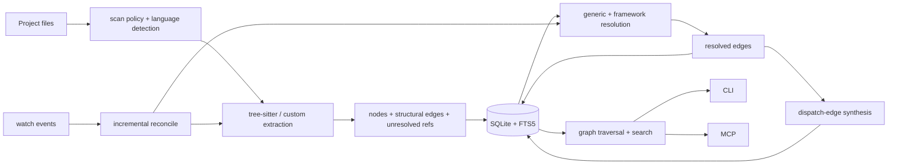

# CodeGraph architecture

This page describes the current Rust implementation. It covers ownership and
data flow; detailed CLI, MCP, storage, and golden contracts live in their owning
references.

## Workspace graph

The root `Cargo.toml` workspace list and each crate manifest are authoritative.
The following diagram shows normal (shipped) intra-workspace dependencies; test
and benchmark-only development dependencies are omitted.

```mermaid
graph TD
    core[codegraph-core]
    extract[codegraph-extract]
    store[codegraph-store]
    resolve[codegraph-resolve]
    graph[codegraph-graph]
    mcp[codegraph-mcp]
    watch[codegraph-watch]
    daemon[codegraph-daemon]
    ui[codegraph-ui]
    cli[codegraph-rs / codegraph binary]
    bench[codegraph-bench]

    extract --> core
    store --> core
    resolve --> core
    resolve --> extract
    resolve --> store
    graph --> core
    graph --> extract
    graph --> store
    mcp --> core
    mcp --> graph
    mcp --> resolve
    mcp --> store
    watch --> core
    watch --> extract
    watch --> resolve
    watch --> store
    daemon --> core
    daemon --> mcp
    daemon --> watch
    ui --> core
    ui --> extract
    ui --> store
    ui --> resolve
    ui --> graph
    ui --> mcp
    ui --> watch
    cli --> core
    cli --> extract
    cli --> store
    cli --> resolve
    cli --> graph
    cli --> mcp
    cli --> watch
    cli --> daemon
    cli --> ui
    bench --> core
    bench --> extract
```

| Crate               | Responsibility                                                        |
| ------------------- | --------------------------------------------------------------------- |
| `codegraph-core`    | shared types, node IDs, configuration, classification, logging        |
| `codegraph-extract` | source discovery, language/custom extraction, unresolved references   |
| `codegraph-store`   | SQLite/FTS5 schema, migrations, persistence, queries, leases          |
| `codegraph-resolve` | generic import/name matching and framework-aware resolution           |
| `codegraph-graph`   | traversal, impact, query parsing, search ranking                      |
| `codegraph-mcp`     | tool schemas/engine, rmcp stdio and streamable-HTTP transports        |
| `codegraph-watch`   | incremental reconciliation and filesystem watcher                     |
| `codegraph-daemon`  | detached shared process, IPC, and process registries                  |
| `codegraph-ui`      | browser viewer: loopback JSON API, live channel, embedded `ui/` build |
| `codegraph-rs`      | clap CLI, agent installer, orchestration, shipped binary              |
| `codegraph-bench`   | equivalence oracle and benchmark harness; not shipped                 |

The dependency direction keeps extraction independent of persistence and keeps
storage independent of query presentation. The CLI is the product assembly root.

## Indexing data flow



### Discovery and extraction

`codegraph-extract` applies project configuration, ignore rules, extension
overrides, generated-file signals, and deterministic path ordering before
parallel file parsing. A file then follows one of these paths:

1. a custom/embedded extractor (Vue, Svelte, Astro, Razor, Liquid, MyBatis XML,
   DFM/FMX);
2. a grammar-backed `LanguageSpec` and generic tree-sitter walker; or
3. file-level handling for formats that intentionally expose no language symbols.

The walker emits file/symbol nodes and structural ownership edges immediately,
and so the value references of a file, which need nothing outside it (see
[`data-model.md`](data-model.md#edges)). Calls, imports, type relationships, decorators, and framework evidence that need
global knowledge are stored as unresolved references. Per-file extraction is
fail-closed: an unsafe tree depth or fatal parse condition cannot leave a partial
replacement graph for that file.

File parsing can run in parallel because each input is independent. Persistence
and later resolution restore stable order before output; scheduler completion
order is never a graph contract.

### Storage

`codegraph-store` owns a project-local SQLite database with FTS5. Fresh databases
start at the current schema; older supported databases advance through ordered,
transactional migrations. Foreign keys, WAL behavior, indexes, FTS triggers, and
lease/state gates are configured by the store rather than by callers.

See [`data-model.md`](data-model.md) for the current schema version, tables,
indexes, and migration history.

### Resolution

`ReferenceResolver` reads the complete extracted snapshot (or the bounded
streaming path for very large graphs), then applies deterministic strategies.
Every entry (the full index's batches, the serial pass, a sync's scoped pass)
resolves and persists the wiring references first, imports and `extends`/
`implements` supertypes, and the rest after them, so a call on a receiver
typed as a subclass reaches a method its base declares within one pass. A C
or C++ base is resolved only by C++ name lookup (the scopes around the
deriving class, its file's namespace aliases and `using` lines, a
translation unit's own classes), never by the strategies below:

1. language-aware imports, re-exports, packages, and paths (a CommonJS
   `require('./x')` imports its file, and a call through a `require` binding
   follows `module.exports`, `exports.name = …`, a `require(…).member` and a
   `.default` the way the module exports them; `export * as ns` exports the
   namespace alone, a namespace import's `z.core.fn()` continues into it, and
   `import { default as X }` is the default import; a Python name imported
   from a package follows the package's named and star re-exports to its
   definition, three modules deep);
2. qualified, scoped, receiver/type, lexical, and exact-name matching (a
   receiver written as, or inferred to be, a type the project does not declare
   stops the name guesses, except that a C# call still reaches the one
   project extension method in scope that takes that type as `this` and fits
   its arguments; a class-name receiver also reaches the class
   methods its declared supertypes provide; a receiver-word guess never takes
   a framework-dispatched handler, an unnamed test double or the caller
   itself; in a language that overloads by arity, a call then moves to the
   same-owner overload its argument count fits, or in Swift its argument
   labels), then a
   last-resort fuzzy match that ignores case only in PHP, Pascal and CFML,
   whose identifiers do;
3. detected `FrameworkResolver` implementations; and
4. bounded follow-up passes for relationships that require graph conformance.

The selected target then passes fail-closed correctness gates: language/module
visibility, C-family macro and translation-unit scope, Go local bindings,
external-import locality, and target-kind eligibility. A JS-family import is
from outside the repository only when the importing file's package.json, or
an enclosing one, declares the package (a `workspace:`, `file:` or `link:`
dependency is the repository's own, and a Deno import map counts), or it is a
Node built-in, `@std/…`, a runtime scheme (`node:`, `npm:`, `jsr:`) or a
framework's virtual module (`$app/…`, `astro:…`); an alias the resolver does
not follow (`$lib/…`, `~/…`) stays the project's. A JS-family import's path
alias comes from the `tsconfig.json` or `jsconfig.json` nearest the importing
file below the root that declares `paths` (a monorepo app's own `@/*`, upstream
#2165), then from the root's. Calls in Vue, Svelte and
Astro components follow the JS/TS rules and, like ArkTS, see the JS
built-ins, unless the file imports its own binding of the built-in's name.
A result that lands on
the referencing node itself is kept only when nothing rules it out: a call
written through `super` / `base` / `parent::`, on another object's value, or
from a value's initializer is not a self-call, and a type never inherits from
itself (the other type of its name its written qualifier leads to is taken
instead, or none). A name match from non-test code never reaches a symbol
in a test suite (a test source set, a `tests/` / `spec/` / `e2e/` tree, a
`FooTest.kt` / `test_foo.py` / `foo.test.ts` / `foo_unittest.cc` file): test
support a project ships (`testing/`, `fakes/`, a `*-test` module) stays in
reach, and so does a C or C++ file the reference's translation unit
includes. No name match reaches a route, which is named by the URL it serves: a
Django URL that reads like a name (`path('path', …)`) answers no call or
import of `path`, and no call's name match reaches a Spring config key, a
YAML or Properties `constant` (upstream #1180). A type name a declaration around the reference declares as a type
parameter (`class Foo<T>`, `def f[A]`, `<T> T max(`, `template <typename T>`) is
that parameter, never a project type of its name; a Scala def's value
parameter is that parameter, and a bare Scala type name reaches another
type's member only from inside it, a subtype, or a file importing its members
(otherwise the type of that name in scope is taken). A function or type
declared inside a function is reached only from inside it, and a Python name
passed as a value that its function binds (a parameter, an assignment, a
`for` / `as` target) is that local, unless a pytest fixture of its name is in
reach (its own module, or a `conftest.py` above it); a JS/TS name the calling
function binds itself (a parameter, or a `var` / `let` / `const` above the
reference) is that local, never a same-named function elsewhere in its file,
and a name destructured from a call's result (`const { login } = useAuth()`)
is the function the callee returns under that key.
A name match from another file never reaches an ES module's top-level binding
the module does not export (the `export` keyword, an `export { … }` list,
`export default x` and `export default { … }` export it; classic scripts,
CommonJS and `.d.ts` files keep their globals), nor a declaration in a Svelte
instance `<script>` or a Vue `<script setup>` (a `<script module>`, a plain
Vue `<script>` and a type a `<script setup>` exports stay importable). A name
match from another file never reaches into a minified script (`*.min.js`, `*-min.js`, a script
whose text is mostly code on lines of a thousand characters, or a webpack
build), though what an import names still binds and calls inside the script
still resolve; a sync that changes such a script re-resolves the references
naming its symbols, since its verdict can flip with no symbol moving. Pure JS-family alias
bindings may forward to a unique callable; wrappers and ambiguity stop at the
binding. A framework-resolved edge carries its own reachability proof and is not
erased by ordinary source-language visibility (for example Tauri IPC to a
private Rust command).

The registered framework candidates are Laravel, Drupal, Express, NestJS, React, Vue, Godot, Tauri,
Nuxt, React Router, TanStack Router, Next.js, Svelte, SvelteKit, Vue Router, Angular Router, Astro, Django, Flask, FastAPI, Rails, Spring, Play, Expo Router, GoFrame, Rust (axum and actix), ASP.NET, SwiftUI, UIKit and Vapor. Strategy 1 asks them in this order: the first to answer `>= 0.9` wins, and among lower answers the most confident, the earlier on a tie. A port takes the place upstream's `FRAMEWORK_RESOLVERS` gives it among its ported neighbours (Laravel and Drupal first, Express before NestJS, Astro between Angular Router and Expo Router, Django, Flask and FastAPI after Astro, Rails after FastAPI, Spring and Play after Rails, Rust and ASP.NET after GoFrame, SwiftUI, UIKit and Vapor after ASP.NET), and one placed ahead of others answers below `0.9` or only for references they do not claim. Each activates only when its detection guard
matches, and resolves only references written in its own languages (React
and Vue their scripts', Express and NestJS TypeScript and JavaScript, Django, Flask and FastAPI Python, Rails Ruby, Spring Java, Kotlin, YAML and
Properties, Play Scala, Java and YAML, Laravel PHP, Drupal PHP and YAML, ASP.NET C# and Razor, the `rust` resolver Rust, SwiftUI, UIKit and Vapor Swift, Tauri the JS-family
`invoke` sites and Rust; Godot and Astro stay universal), and a resolver's
claim takes a reference past the name prefilter only in those languages
(upstream `frameworksFor`, #2415); Laravel's claim takes only a Laravel
route's references, and Drupal's only a routing file's and the `hook_X`
names, where upstream claims the names wherever they are written. React and NestJS detect a
dependency in any `package.json` detection reads (upstream #2395): the root's
and up to 24 nested ones, first those one or two directories down on the path
to an indexed file, then those deeper above JavaScript-family code
(`src/Web/ClientApp/`), shallowest first, never one inside `node_modules`. A
framework may name the packages its apps declare (upstream #2129); when some
manifest declares one, its extractor runs only on files whose nearest
`package.json` naming any such framework names it, so a router reads its own
app in a monorepo. Nuxt names `nuxt`, `nuxt3` and `@nuxt/kit`, Next.js `next`, Vue Router `vue-router`, `nuxt` and `nuxt3`, Expo Router `expo-router`. Nuxt is detected by one of them or a `nuxt.config.*` file (upstream #2130) and reads its file routes: a `pages/` file is a screen route (a top-level `pages/index.vue` is `/`) that `calls` its own file's component (#2267), never a same-named one; `server/api/` files are endpoints and `middleware/` files functions. Vue resolves component references, compiler macros and Nuxt's auto-imports and extracts nothing. Next.js is detected by its dependency or a `next.config.*` beside a route file and reads `app/` and `pages/` file routes (F3): a page is a route named by its path (a `(group)` dropped, `[slug]` as `:slug`, `[...all]` as `:all*`) that `calls` its default export; a `route.ts` handler is one `GET /path`-style endpoint per exported method, referencing it; a `pages/api/` file is `ANY /path`; layouts, parallel and intercepting routes are none. A Next navigation call (`router.push`, `replace`, `prefetch`, `redirect`, `permanentRedirect`, `NextResponse.redirect`) under a Next app whose href names a page becomes a `navigates` edge with the `href` and `navMethod`, one per arm of a conditional; a path two apps serve goes to the calling app's page. Expo Router is detected by its dependency or an `app/_layout` beside an `app.config.*` and reads the files under `app/` (or `src/app/`) as screens (F2): a screen is a route named by its path (a `(group)` dropped, `[id]` and `[...rest]` kept, `index` the directory's own path) that `calls` its default export; layouts, `_` and `+` files other than `+not-found` are none, and a `+api` file is one `GET /path`-style endpoint per exported method (#2135). A navigation call (`router.push`, `replace`, `navigate`, `dismissTo`, or a project wrapper named like `safePush`) becomes a `navigates` edge to the screen its href names, a relative href read from the calling screen's directory; the call matches only the screens of its own Expo app (the longest directory above an `app/` that holds it), so a file under no Expo app is not read, and a path two screens of that app serve stays unresolved. React extracts only React Router routes, from `.tsx`/`.jsx` files too (components and hooks are the tree-sitter extractor's, upstream #841): a JSX-capable file's `<Route>` elements and, in a file that makes a router (`createBrowserRouter`, `createRoutesFromElements`, `useRoutes`, …), its route objects, each a route named by its path with nesting composed (F4). An index route is the page at its parent's address, a route around others is the layout they render inside (a reference whose edge carries `layout: true`), a route that renders `<Outlet />` renders nothing of its own, a `lazy: () => import('./x')` route renders the module's default export or else its `Component` export, through barrels (#2400), a loader that picks an export (`const { Page } = await import('./x'); return { Component: Page }`, a `.then` callback, `(await import('./x')).Page`, an `async lazy()` method, React Router 7's object of lazy properties) renders that export (#2480), one that hands back `Outlet` renders nothing of its own, one that hands over only a `loader` makes no page, and a path built from a constant (`paths.app.root.path`) is named from the constant's object literal before anything resolves, keeping its id; the route's language is tsx in a `.tsx` file and jsx elsewhere. A table another file hands the router is read too (#2400, #2423, #2668, #2672): from each non-test file that imports React Router and hands a table to `useRoutes` or `create*Router`, or maps an array into `<Route>`s from each item's own fields (`AppRoutes.map(({ element, ...rest }) => <Route {...rest} … />)`), the table is found where it is declared, imported or re-exported, or as what a function a value calls returns (each `return` of its own, through `useMemo`), and its route objects and the tables they name (`...authRoutes`, `children: adminRoutes`) become routes under the path they are mounted at, inside the layouts around them when the table is written in the same file; a `{ path, element }` menu nothing hands the router is none. These routes (`route:<file>:<line>:table:<path>`) are cross-file nodes: after the constant naming, a pass compares the routes every table gives now with the ones stored, inserts the new ones with their references and replaces one whose name or references changed, the edges that reached a removed one re-resolved, before anything resolves, in an index, a migration, every sync and the orphan sweep. A PascalCase module-level value a file declares is, wherever that file uses it, the component of the module its lazy wrapper loads (`Loadable(lazy(() => import('./x')))`, `dynamic(…)`, either branch of a conditional), else the function it wraps, else the declaration itself (#2420). React leaves a name the file imports to import resolution, but for a component tag imported from a module of the project: it renders what that module exports under the name, through an `index` that forwards it, past a wrapper around it (`export default observer(AppSidebar)`, `memo(Blurhash)`) or a value holding another module's component (#2563), where import resolution's answer differs or is missing. React reaches a hook or context by name only in the file that declares it (#2120, #2240). React Router is detected by `react-router`, `react-router-dom` or `react-router-native`: a navigation call (`history.push`, `history.replace`, `navigate`, `router.navigate`, `redirect`) whose href names a route of its own app (the directory above the file's first `src`, `pages`, `app` or `routes` segment, else its own) becomes a `navigates` edge with the `href` and `navMethod`, a route-config helper's href (`paths.x.getHref(id)`) and a local's static initializer read too, one edge per arm of a conditional; a path two routes of that app serve stays unresolved. TanStack Router is detected by `@tanstack/react-router`, `@tanstack/solid-router`, `@tanstack/router`, `@tanstack/react-start` or `@tanstack/start` and reads each file's own routes (F5): `createFileRoute('/posts/$postId')` names its route by the pattern, `$id` written `:id`, a bare `$` a splat, `_layout` and `(group)` segments dropped and an index's trailing `/` its parent's address, and `createRoute({ path, getParentRoute })` composes its address through the parents its file declares; a pathless layout, a root route, a route whose index child renders its address, and a file route in a file that renders `<Outlet />` or is named `*.route.tsx` are no address of their own, one address of a file is one route with its index winning, and each route `calls` the component it names. A navigation call (`navigate({ to })`, `router.navigate`, `Route.navigate`, `throw redirect({ to })`) whose `to` pattern names a route of its own app becomes a `navigates` edge with the `href` and `navMethod`; a computed `to`, a search-only navigation and a path two routes of that app serve stay unresolved. Vue Router is detected by `vue-router`, `nuxt` or `nuxt3` and reads the routes tables (F6) of a file that builds a router (`createRouter`, `new Router`, a `create*History` call), imports `vue-router`, writes a `routes` array or sits in a `router/` or `routes/` directory: a `routes: [` field or a declaration named for routes (`constantRoutes`, `const routes: RouteRecordRaw[]`, `tableRouter`) holds route objects, each entry a route of its own named by its path, a child's joined onto its parent's (`children` read only from an array written in place), that `calls` the component it names and references each parent's component as a layout (`layout: true`); a parent that a child's path claims or that redirects is a frame, not a page, and a top-level path not starting with `/` is none (#2130). The component is what the router file's import of an identifier takes (a named import the module-level node exported under that name, at its declaration or through an export list or the modules that re-export it, a default import the module's default export), or the default export of the module a lazy `() => import(…)` names, a `.vue` file's own component; the module is found as the router file resolves the import or else, for an alias, as the one file of its app whose path ends as the specifier does. A route names an identifier through a reference only Vue Router answers (`component:<name>`): where the import names a module that is not found or holds no such component, the route renders nothing, and only an identifier no import reaches is looked up by name (a declaration of the routes file, else a component of that name). A navigation call (`router.push`, `router.replace`, `this.$router.push`, `$router.push`, `navigateTo`) reaches by name the route of its own app that the table names so (`{ name: 'login' }`, an edge with `by: name`), and otherwise by its path a config route or a Nuxt page of that app. The destination is read whole: a string, a template whose holes fill whole segments (`` `/posts/${id}` ``), a conditional of them or a local initialized to one, and of an object destination only its own `name` and `path`; a concatenation (`'/redirect' + fullPath`, a comment between the two or not) or a hole sharing a segment (`` `/redirect${fullPath}` ``) reaches nothing, and a name or path two entries of the app carry stays unresolved. A bare `navigateTo` is the Vue resolver's Nuxt auto-import first, as in colby at `e8ddc4e2`: it binds to its own caller and navigates nowhere. Svelte is detected by `svelte` or `@sveltejs/kit` in the root `package.json` or by any `.svelte` file and reads a SvelteKit page's route: a `+page.svelte` under a `routes/` directory is a route named by its directory below the first `/routes/`, a `(group)` folder and a parameter's `=matcher` dropped (#2131: `[slug]` is `:slug`, `[[lang]]` `:lang?`, `[...rest]` `*rest`); a layout, error page, endpoint or loader is none. It resolves a Svelte 5 rune to its own caller, `$store` in a component to the one variable or constant of that name its file declares, an import of `$lib/x` to the file `src/lib/x` of the importing file's app (as written, or with `.ts`, `.js`, `.svelte`, `/index.ts` or `/index.js`), an import of `$app/…` or `$env/…` to its own file, as colby does, and a capitalized call to the one component of that name in the calling file's directory or below, else to the one anywhere. SvelteKit is detected by `@sveltejs/kit` in any `package.json` detection reads: a `goto(path)` or `redirect(status, path)` whose destination names a page of its own app becomes a `navigates` edge with the `href` and `navMethod`, one per arm of a conditional; the destination is read whole, as Vue Router reads it (for `goto` also a local initialized to one), and a `[[optional]]` page also serves its path without the parameter unless a page serves that path. A rest page, a computed destination, an absolute URL and a path two pages of the app serve stay unresolved. Angular Router is detected by `@angular/router` or `@angular/core` and reads the routes arrays of each TypeScript file (no declaration file) that imports `@angular/router` (upstream #2113): an array typed `Routes` or `Route[]`, handed to `RouterModule.forRoot`, `RouterModule.forChild` or `provideRouter`, a file's `export default [`, or a `const` whose array says `as Routes` or `satisfies Routes` holds route objects, their fields in any order, each child's path joined onto its parent's (`children` read only from an array written in place). Each screen is a route (`route:<file>:<line>:<path>:angular`) that references the component it renders, a `component` class through import resolution or the `@Component` class a `loadComponent` import picks (the member `.then(m => m.X)` or `(await import(…)).X` takes, else the file's default-exported component, else its only one, else its default-exported class), and references the component of each layout around it in its own file (`layout: true`; the layouts around a mount are not carried into the file it loads). A route with `children` is a layout, a screen only where no child claims its address; a `redirectTo` entry, a `**` path, a custom `matcher` and a computed path are no screens, and of two entries of a file at one path the first is the route. A file's routes are named as if the file were mounted at `/` and renamed after extraction under the path that lazy-loads the file (#2133): a `loadChildren` import, followed through barrels (an Nx library's `src/index.ts`, up to four hops) and through the routing modules an NgModule imports, a file mounted from two places under the first mount in path order, as in colby, and each file of a cycle of mounts under its own chain up to the file that repeats. A constant path segment (`internalRoutes.account.path`, an enum member, a class's static field or the object it holds, a destructured or plain alias, a `$localize` default, a `+` of strings and constants, a template whose holes are constants) is read from its declaration, through the barrels that forward it, and a constant's nested object only where it is written in place. A navigation call (`router.navigate`, `navigateByUrl`, `createUrlTree` or `parseUrl`, on `this.router` or `this._router` too) whose destination names a route of its own app becomes a `navigates` edge with the `href` and `navMethod`: the app is the nearest directory above a routes file that holds an `angular.json` or an `nx.json`, else its conventional app root, and a file under no app's root uses the only app's routes. The destination is a command array (`['/article', slug]`: a hole for each computed element, a matrix-params object ignored, and for a call a bare first segment such as `['project', 'issue', id]` read from the root), a static string, `'/editor/' + slug`, a route constant (`internalRoutes.zen.routerLink`, or one whose arrow function builds the commands), a property of the calling class, or any of those `.concat(…)`, one segment per argument; a conditional or a template is read whole, a relative arm or one that leaves the site (`//auth.example.com/login`) drops out first, and a call with `relativeTo` reaches nothing. A redirect gives its path the route it leads to, followed through the other redirects at most four hops, and `/` that no route or redirect serves takes the route of the app's root `**` redirect; a path two routes serve, or whose redirects lead to two routes, stays unresolved, and a route or a redirect whose path holds a constant the cross-file pass could not read is in no table, though its app still counts among the apps. Its templates' `routerLink`s are the synthesis stage's Angular pass's. Astro is detected by a truthy `astro` among the root `package.json`'s `dependencies` and `devDependencies` (a dev dependency overriding) or by any `.astro` file. Each `.astro`, `.ts`, `.js` or `.mjs` file under a `src/pages/` directory, but for one with a segment starting with `_` below it and a `*.config.*` file, is a route `route:<file>:<path>:1` named by its path (`index` its directory's, `[slug]` as `:slug`, `[...rest]` as `*rest`): a page `calls` its own file's component (#2267), never a same-named one, and an endpoint references each HTTP method it exports (`export const GET`, `export async function POST`). Astro resolves the `Astro` global and its members (`Astro.redirect`, `Astro.cookies.has`), which it claims ahead of the name prefilter, and an `astro:*` module import (`astro:content`, `astro:assets`, …) to their own source node, and, in a `.astro` file only (#2245), a PascalCase name it references or calls to the one component of that name whose path starts with the file's directory, else to the one component of that name in the project; two candidates resolve nothing. Express is detected by `express`, `fastify`, `koa`, `hapi` or `@hapi/hapi`, or by a file whose path holds `routes`, `controllers` or `middleware` and whose text holds `express`, `app.get` or `router.get`, and reads the routes of each `.js`, `.mjs`, `.cjs` and `.ts` file (#1957): an `app.get('/path', …)`-style call on `app` or `router` (a `use` only with a `/` path), and each method of a `router.route('/path').get(…).put(…)` chain, is a route `route:<file>:<line>:<METHOD>:<path>` named `METHOD /path`. The handler alone, the last non-empty argument (a trailing options object dropped, an array read as its last element), decides what the route references: an inline arrow, or a `function` that opens the argument, wrapped in calls or not (`asyncHandler(function …)`), lends the route the calls its body makes, each once, a member call keeping its receiver (`userService.lookup`, `c.text`; #2200, #2261), with keywords, a nested declaration's name, an expression's members and upstream's framework-noise names (`json`, `status`, `find`, …) skipped and each reply (`res.status(404).json(…)`) a call at its own line and column; any other handler is a reference to its last name. A string, template or regex literal never ends an argument (a regex told from a division by upstream's `regexLiteralEndAt` rules, its windows counted in UTF-16 code units), and neither does a comma in a type-argument list (`asyncHandler<Req, Res>(`). After extraction each mount `X.use('/prefix', …, target)` whose last argument names a project file (an inline `require('./x')`, an imported name, or one the file binds to `require('./x')`, with `.default`, `.router` or `.routes` after it or not) composes its prefix down the mount tree, and the mounted file's own Express routes are renamed `METHOD /prefix/path`, keeping their ids: a file mounted at two prefixes keeps its names, another framework's route in a mounted file keeps its name, and a route that no mount renames any more gets its file's name back, in an index and in every sync. Express resolves three name patterns, each through the one candidate of the reference's own file (#2243): a middleware name (`auth`, `cors`, `logger`, `validate…`, `…Middleware`, …) to the file's function, method, variable, constant or class of that name, never an import (#2244); `xController.m` to the method or function `m` whose path names the controller; and `xService.m` (or `Helper`, `Util`, `Utils`) to the one whose path names the service. Its answers are below `0.9`, and a pattern with two candidates answers nothing, leaving the reference to import and name resolution. NestJS takes a provider by its naming convention (`*Service`, `*Controller`, …) only from the reference's own file or the convention file beside it (#2246), and names each route by the path a request takes to it: its module's `RouterModule` prefix and its app's global prefix and URI version (#2117), where a test's `NestFactory.create` (an e2e spec) configures only its own feature's app and never one with an entry point of its own. The routes are renamed in place after extraction, keeping their ids, and a route nothing renames any more gets the name its file gives it back. This finalization runs after framework extraction and before resolution, in an index and in every sync. Django is detected by `django` (in any case) in the root `requirements.txt`, `setup.py` or `pyproject.toml`, or by a root `manage.py`; Flask by the word `flask` in a root `requirements.txt`, `pyproject.toml`, `Pipfile` or `setup.py`, or by an entry script (`app.py`, `application.py`, `main.py`, `wsgi.py` or `__init__.py`, at the root or below; the first 50 in path order) that imports `flask` and calls `Flask(`; FastAPI by the word `fastapi` in a root `requirements.txt` or `pyproject.toml`, by `FastAPI(` in a root `app.py`, `main.py` or `api.py`, or by either below the root (`950686de`): a `requirements.txt`, `requirements-dev.txt` or `pyproject.toml` at any depth, or such a script at most four path segments deep, at most 40 of them read in path order. The root files are read whether or not they are indexed. Each reads its routes from `.py` files, comments and docstrings blanked, columns and the 4,000-unit argument window counted in UTF-16 code units. Django: a `path`, `re_path` or `url` call is a route named by its URL that references the handler's last name, a trailing `.as_view(…)` or other method call dropped (`views.handler.decorated()` references `handler`), or, for `include('app.urls')`, imports that module, which import resolution maps to its `urls.py`; a DRF `router.register(r'prefix', XViewSet)` of a `…View` or `…ViewSet` is a `VIEWSET /prefix` route referencing it. Flask: an `@x.route('/path', methods=…)` decorator is `METHOD /path` with the first method it lists (`GET` without one) and references the next `def`, past other decorators; a Flask-RESTful `add_resource` (or a variant such as `add_org_resource`) makes one `ANY /path` route per path, referencing the resource class; and an `add_url_rule('/path', …)` call, or a call handing a list of paths and a `view_func=` over (a project's wrapper, #2154), makes one route per `/` path and listed method, each once, `ANY` for a class-based view and `GET` for a function when `methods=` lists nothing, referencing the target's last name. FastAPI: an `@x.get('/path')`-style decorator is `METHOD /path` (`/` for an empty path), referencing the next `def`. After extraction each FastAPI router's prefix composes down its mount tree (`bc45e907`): its own `APIRouter(prefix=…)` and each literal `X.include_router(router, prefix=…)` whose router is the file's own or, through a relative import, a module's (`items.router`) or an alias import's (an absolute import's module is not followed yet), and FastAPI's own routes are renamed `METHOD /prefix/path`, keeping their ids: a computed prefix leaves its mount out, a router mounted at two paths keeps its names, another framework's route keeps its name, and a route that nothing renames any more gets its file's name back, in an index and in every sync. Django resolves a model (`…Model`, or one capitalized word), a view (`…View` or `…ViewSet`, a class or a function) and a form (`…Form`), each preferring a file whose path holds `models`, `views` or `forms`, and claims an `…urls` module name past the name prefilter for import resolution; Flask a blueprint variable (`…_bp`, `…_blueprint`); FastAPI a router variable (`router`, `…_router`, preferring a path that holds `/routers/`, `/api/`, `/routes/` or `/endpoints/`) and, at `0.75`, a dependency function (`get_…`, `Depends…`, preferring `/dependencies/`, `/deps/` or `/core/`), the others at `0.8`, none of them for a name the reference's file imports, which import resolution answers. Their name heuristics share one pick (#2225): of the declarations of the name and the resolver's kinds that the reference can see (none inside a function body, a type nested in another file's type only from its own file, one another file may name under its language's rules, no test suite from code that is no test, and for an `extends` never the reference's own type), the one in the reference's file, else in its directory, else in a preferred folder, else in the project; a tier with two or more answers nothing and stops the search, and a pick in another code family than the reference answers nothing. Rails is detected by a root `Gemfile` naming the `rails` or `railties` gem, read whether or not it is indexed, by a root `config/application.rb`, `app/controllers/application_controller.rb` or `config/routes.rb`, or by an indexed `config/routes.rb` at any depth (an engine's), and reads each `.rb` file on its comment-stripped text (`=begin`…`=end` blocks and `#` comments blanked, strings kept). A routes file, one whose text calls `routes.draw` or that sits in a `config/routes/` directory, is read with its blocks (#2155): `namespace` prefixes the paths and controllers of the routes inside it and `scope` their paths (a leading string or `path:`) or controllers (`module:`), a `resources … do` block nests its children under the parent's `:<singular>_id`, `member` and `collection` blocks add actions to the member and collection paths, a statement whose `[` or `(` stays open takes the following lines, and `root`, a verb route (`to:` or `=>`, or bare inside a resource) and `match` (method `ANY`) are routes `route:<file>:<line>:<METHOD>:<path>:<target>` named `METHOD /path`, qualified `<file>::route:<target>` and recorded once per id. Any other `.rb` file contributes its explicit `get 'path', to: 'c#a'` routes (`route:<file>:<line>:<METHOD>:<path>`, qualified `<file>::route:<path>`) and its `resources :x` lines (seven REST routes, six for `resource`; `route:<file>:<line>:<VERB>:<controller>#<action>`, qualified `<file>::route:<controller>#<action>`). Both read `only:` and `except:` in each form Rails accepts (#2269: an array, `%i[]` or `%w()`, a symbol, a string, `:only =>`), and every route references its `controller#action` at its line, column 0. Rails resolves `controller#action` at `0.85` to the action, a Ruby method or function, in `app/controllers/<controller>_controller.rb`, else to the one in the files of the Ruby classes named for the controller's last segment (`ZonesController` for `admin/zones`), of those whose path ends with `/<controller>_controller.rb` when the controller has a module and some do; two answer nothing. A CamelCase name resolves at `0.8` to the model class in `app/models/<snake>.rb`, then `app/models/concerns/<snake>.rb`, else to the one Ruby class of its name in a path holding `app/models/`; a `…Controller` at `0.85` to the class in `app/controllers/<snake>.rb`, `app/controllers/api/<snake>.rb` or `app/controllers/api/v1/<snake>.rb`, else to the one Ruby class of its name in a path holding `controllers/`; a `…Helper` at `0.8` to the module in `app/helpers/<snake>.rb`, and a `…Service` or `…Job` to the class in `app/services/`, `app/jobs/` or `app/workers/`. Spring is detected by `spring-boot` or `springframework` in a root `pom.xml`, `build.gradle` or `build.gradle.kts`, or by an indexed `.java` file holding `@SpringBootApplication`, `@RestController`, `@Service` or `@Repository` (read 256 at a time in path order, the first batch holding one ending the scan); Play by `playframework`, `"play"`, `sbt-plugin`, `PlayScala` or `PlayJava` (ASCII letters in any case) in a root `build.sbt`, by a root `conf/routes` or `conf/application.conf`, or by any indexed Play routes file (#2156): `conf/routes`, a path ending in `/conf/routes` or one ending in `.routes`, matched case-sensitively, which is indexed as a YAML file whether or not Play is detected. The root files are read whether or not they are indexed. Spring reads its config files and the `.java` and `.kt` files, comments blanked, columns and the 600-unit method window counted in UTF-16 code units. A `@GetMapping`-style annotation (`Get`, `Post`, `Put`, `Patch`, `Delete`) or a method's `@RequestMapping` (the HTTP method its `method =` names, else `ANY`) is a route `route:<file>:<line>:<METHOD>:<path>` named `METHOD /path`, one per path of the file's first class-level `@RequestMapping` (an empty prefix without one) joined with each path it lists (`value`, `path` or the unnamed argument, each a string or a `static final String` constant of the same file; #1461, #1811), that references the first method declared (`fun name(`, or `public … name(` and the like) in the 600 units after it. A config file (`application` or `bootstrap`, with a `-profile` suffix or not, `.yml`, `.yaml` or `.properties`) holds a `constant` per leaf key, `spring-config:<file>:<line>:<key>`, qualified by its dotted key, and never its value (#722). An `@Value("${key}")` or `@ConfigurationProperties("prefix")` is a binding constant (`spring-value:…`, `spring-cp:…`) whose reference only Spring resolves: to the key spelt alike once lower-cased with `-` and `_` dropped (relaxed binding), one at `0.9` and of several the base file's (`application.yml`, `bootstrap.properties` and the like, without a profile), else the shortest file name's, at `0.75`, and for a prefix to the shortest key under it at `0.85`, of keys alike in rank the one whose file shares the most directories with the binding's; a key no config file holds, or one without a dot (#1180's gate), leaves the binding unresolved. A Java or Kotlin name other than an `extends` or `implements` is, by Spring's conventions (#1827), the declaration of that name the shared name pick above finds: a class or interface for `…Service` and `…Repository` and a class for `…Controller`, at `0.85`, preferring a `/service/`, `/repository/` or `/controller/` folder (or its plural), a class for one capitalized word at `0.7` (`/entity/`, `/model/`, `/domain/`), and a class for `…Component` or `…Config` at `0.8` (`/component/`, `/config/`); a rule whose pick answers nothing ends the conventions. Play reads each line `METHOD /path pkg.Controller.action(…)` of a routes file (`GET` to `OPTIONS`; a comment or a `->` include is none) as a Scala route `route:<file>:<line>:<METHOD>:<path>` named `METHOD /path` that references `Controller.action`, and resolves that name at `0.9` to the first method or function `action` in the file of a class `Controller`, of those classes the one whose file shares the most directories with the reference's; two at that distance, or a pick in another code family than the reference, answer nothing. Only a routes file's references are Play's, and they take no other strategy's answer: a line Play answers nothing for stays unresolved, and a `Controller.action` that Scala or Java code writes is import and name resolution's. Laravel is detected by a root `artisan` or `app/Http/Kernel.php`, read whether or not they are indexed, and reads each `.php` file holding `Route::` on its comment-stripped text (#2099): a `Route::get` call (to `options`, and `any`) is a PHP route `route:<file>:<line>:<METHOD>:<path>` named `METHOD /path`, and a `Route::resource` or `apiResource` call one named `resource:path`, each path under the prefixes of the groups around it (`Route::prefix('admin')->…->group(…)`, `Route::group(['prefix' => …], …)`; a computed prefix is the segment `{prefix}`) and qualified `<file>::route:/path`. A verb route references its handler as `Controller@action` (`[C::class, 'm']` drops C's namespace; a string `'Ns\C@m'` keeps it below `App\Http\Controllers\`, #2271), and a resource route imports its controller, its options array skipped. Each route is then renamed, keeping its id, by the prefix its file is served under: a group whose last argument is no closure mounts the file that argument names under its prefixes, a `require`, `include` or `loadRoutesFrom` under the prefixes of the groups around it, and Laravel 11's `withRouting` its `web:` file at the root and its `api:` file under `apiPrefix:` (`api` by default), a mount naming an existing `.php` file inside the project by `base_path('x')`, `__DIR__.'x'`, `dirname(__DIR__).'x'` or `'x.php'`, and read from each `routes/` file and each other `.php` file naming `routes/` or `withRouting(`; `routes/api.php` is served under `/api` when nothing mounts it and no `withRouting(using:)` loads routes by code, prefixes compose down the include tree (eight rounds at most), a file reached at two prefixes keeps its in-file paths, and every name is recomputed from the qualified name, so a mount that goes away is undone, in an index and in every sync. Laravel resolves `Controller@action` at `0.9` to the method in `app/Http/Controllers/<path>.php`, else to the one method of that name in the files of the PHP classes so named in a path holding `Controllers`, those whose file ends with a written namespace path first, and a resource route's controller at `0.9` to the one such class whose file ends with the written path, else to the only one of its name; two candidates answer nothing. Its `Model::method`, facade and helper rules, ported from upstream, answer no reference an extractor writes. Drupal is detected by a root `composer.json`, read whether or not it is indexed, whose `name` starts with `drupal/`, whose `type` starts with `drupal-` or whose `require` or `require-dev` names a `drupal/` package, or by an indexed `*.info.yml` beside a `*.routing.yml`, `.module`, `.install` or `.theme` file (#271). Each route of a `*.routing.yml`, a name line a `path:` follows, is a YAML route `route:<file>:<line>:<path>` named by its path (`/hello [GET,POST]` with a `methods:` list) and qualified `<file>::<route name>`, referencing its `_controller`, `_form`, `_entity_form`, `_entity_list` and `_entity_view` handlers; each procedural hook implementation in a `.module`, `.install`, `.theme`, `.inc` or `.php` file references `hook_X` from the function's node, by an `Implements hook_X()` docblock or, failing one, by its module's name prefix (`mymodule_form_alter` is `hook_form_alter`). Drupal resolves a routing file's `\Drupal\…\Class::method` (or a service's `name:method`) at `0.9` to the method in the file of the one PHP class so named, or of several the only one whose file holds it, and at `0.7` to the class when its file has none; a bare namespaced class at `0.85` to the one PHP class of its last segment; and `hook_X` at `0.75` to the one PHP function of a hook file whose name ends with `_X`, which a definition `function hook_X` (in an `*.api.php`) outranks at name matching's exact `0.9`. GoFrame is detected by `github.com/gogf/gf` in the root `go.mod` and reads each Go file's request types (#747): a type whose first field is a `g.Meta` with a `path:` tag is a route named `METHOD /path` (`ANY` when the tag names no method), its request type qualified by the file's package kept for the synthesis stage, which joins the route to the method serving it; it resolves no reference, and an addon's routes under `addons/` are read only where a project re-includes that directory, which the default skips for Godot. Rust (the `rust` resolver, upstream `rust.ts`: axum's and actix's routes) is detected by a root `Cargo.toml`, read whether or not it is indexed. It reads each `.rs` file holding `.route`, `#[` or `web::resource` on its comment-stripped text (nested `/* */` and `//` comments blanked byte for byte, strings kept; an attribute's end column and a resource chain's window counted in UTF-16 code units) for three kinds of route, each named `METHOD /path`, `route:<file>:<line>:<METHOD>:<path>` qualified `<file>::route:<path>`: an attribute (`#[get("/users")]`, actix's and rocket's) on its line, referencing the next `fn` declared after it at that line, column 0; an axum `.route("/users", get(list_users).post(create_user))`, a route on the `.route` line for each method router at the call's top level (a `get(` inside a closure handler is none, #2359); and actix's builder API, each `web::get().to(handler)` of a `web::resource("/path")` chain on the line of its `web::get()`, else a chain's leading `.to(handler)` as `ANY` on the resource's line (the chain reaching 500 units, the next resource, or the `)` that closes the call it is an argument of), and an App-level `.route("/path", web::get().to(handler))` on its line. An axum or builder route references its handler expression's last `::` segment where that name is written, on its line and at its byte column (#2359), which the Rust scope rule reads. It resolves a Rust name by upstream's conventions, in order, the first three through the shared name pick under the Rust scope rule, so a pick is an item the reference can name and never one inside a function body (#2214, #2224): a function for `…_handler` or `handle_…` (`/handlers/`, `/handler/`, `/api/`, `/routes/`, `/controllers/`) and a struct or trait for `…Service` or `…Repository` (`/services/`, `/service/`, `/repository/`, `/domain/`) at `0.8`, and a struct for a letters-only capitalized name at `0.7` (`/models/`, `/model/`, `/entities/`, `/entity/`, `/domain/`, `/types/`); a rule with no candidate hands over to the next, and one whose pick answers nothing ends them, the module rule's too. A name of lowercase letters and underscores then names a module: the file node of the root's `src/<name>.rs` or `src/<name>/mod.rs` at `0.6`, else of the `src/lib.rs` or `src/main.rs` of the Cargo workspace crate `<name>` at `0.95` (#151), the first the index holds. The workspace's crates come from the root manifest's `[workspace] members`, read by lines and quotes as upstream reads them (a glob member walks the project's directories, sorted by name, at most six levels below its static prefix, skipping `target`, `node_modules`, `.git`, `dist`, `build` and every directory whose name starts with `.`), each named by its manifest's `[package] name` and by that name with `-` read as `_`; a member outside the project root is neither read nor listed, and a name two members give names neither. ASP.NET is detected by an indexed `.csproj` naming `Microsoft.AspNetCore`, `Microsoft.NET.Sdk.Web` or `System.Web.Mvc` (the index holds no project file, here or in upstream, unless a configuration adds one), by a root `Program.cs` holding `WebApplication`, `CreateHostBuilder` or `UseStartup`, or a root `Startup.cs`, both read whether or not they are indexed, or by an indexed controller, entry point, endpoint or extension file (`…Controller.cs`, `Program.cs`, `Startup.cs`, `…Endpoint.cs`, `…Endpoints.cs`, `…Extensions.cs`, or a file directly in an `Endpoints/` folder) whose source holds an `[ApiController]`, `[Route` or `[HttpGet`-style attribute or one of `ControllerBase`, `: Controller`, `MapControllers`, `WebApplication`, `Microsoft.AspNetCore`, `IEndpointGroup`, `EndpointGroupBase` and `RouteGroupBuilder` (read 256 at a time in path order, the first batch holding one ending the scan). It reads each `.cs` file holding `[Http`, `.Map` or `Configure` on its comment-stripped text (stripped as Java is; columns and windows counted in UTF-16 code units) for four kinds of C# route, each named `METHOD /path` and referencing its handler at its line, column 0: a verb attribute (`[HttpGet]`, `[HttpPost("{id}")]`) under the file's first class-level `[Route("…")]` prefix (a `[controller]` placeholder kept as written), `route:<file>:<line>:<METHOD>:<path>` qualified `<file>::route:<path>`, that references the first method declared in the 600 units after it; a minimal API (`app.MapGet("api/todos", GetTodos)`, its path from the root, #2158) that references its handler expression's last identifier, a lambda none; an endpoint group's handler-first call (`group.MapPost(CreateTodoItem)`, `group.MapPut(UpdateTodoItem, "{id}")`, `bc45e907`), its group the last class declared before it, served under the file's first `RoutePrefix` literal or `/<group>` and qualified `<file>::group:<group>:<METHOD>:<sub-path>`; and a FastEndpoints endpoint's verb calls (#2158), from its class's `void Configure() {` on, within 3000 units and up to the first one past that method's closing brace, one route per string literal (`{nameof(X)}` read as `X`) or, for a lone `X.Y` constant, one named `METHOD X.Y` and qualified `<file>::fastendpoint:<METHOD>:const:X.Y`, each referencing the first `HandleAsync` or `ExecuteAsync` from the class on. Each pass then renames, keeping the id, a constant route by the one value the C# classes and structs named `X` give their `const`, `static readonly` or `static` string field `Y`, and the group routes of a file with no `RoutePrefix` literal under the app's head, `/api/` in `MapGroup($"/api/{groupName}")`, which the first of the `.cs` files holding `MapGroup` (400 at most, in path order) that writes one gives; every name is recomputed from the qualified name, so a constant or head that goes away is undone, in an index and in every sync. ASP.NET resolves a C# or Razor name (a page's `@model IndexModel`, #2415) by its conventions, in upstream's order, each through the shared name pick: a class for `…Controller` (`/Controllers/`), a class or interface for `…Service` or `I…` (`/Services/`, `/Service/`, `/Application/`) and for `…Repository` (`/Repositories/`, `/Repository/`, `/Data/`, `/Infrastructure/`), at `0.85`, a class for a letters-only name at `0.7` (`/Models/`, `/Model/`, `/Entities/`, `/Entity/`, `/Domain/`), and a class for `…ViewModel` or `…Dto` at `0.8` (`/ViewModels/`, `/ViewModel/`, `/DTOs/`, `/Dto/`); a rule with no candidate hands over to the next, and one whose pick answers nothing ends them. SwiftUI is detected by an indexed `.swift` file holding `import SwiftUI` or an indexed path ending in `.xcodeproj` or `.xcworkspace` (Xcode's are directories, so the second holds only where a configuration indexes a file so named, in upstream too), UIKit by an indexed `.swift` file holding `import UIKit`, `UIViewController` or `UIView` (a comment's and `UIViewRepresentable`'s count), and Vapor by a root `Package.swift` holding `vapor`, read whether or not it is indexed, or an indexed `.swift` file holding `import Vapor`; each reads the `.swift` files 256 at a time in path order, the first batch holding one ending the scan. The three resolve only Swift names (#2242: an Objective-C reference takes no Swift convention), each by its conventions in upstream's order through the shared name pick: SwiftUI a struct for a capitalized `…View` (`/Views/`, `/View/`, `/Screens/`, `/Components/`, `/UI/`) and a class for `…ViewModel`, `…Store` or `…Manager` (`/ViewModels/`, `/ViewModel/`, `/Stores/`, `/Managers/`, `/Services/`), at `0.85`, then a struct or class for a capitalized letters-only name at `0.7` (`/Models/`, `/Model/`, `/Entities/`, `/Domain/`); UIKit a class for `…ViewController` (`/ViewControllers/`, `/ViewController/`, `/Controllers/`, `/Screens/`) at `0.85`, for `…View` (`/Views/`, `/View/`, `/UI/`, `/Components/`) at `0.8` and for `…Cell` (`/Cells/`, `/Cell/`, `/Views/`, `/TableViewCells/`, `/CollectionViewCells/`) at `0.85`, then a protocol for `…Delegate` or `…DataSource` at `0.8` in any folder (a Swift `protocol` is an interface node, so only an Objective-C `@protocol` is one); Vapor a class or struct for `…Controller` (`/Controllers/`, `/Controller/`, `/Routes/`) at `0.85`, a class for a capitalized letters-only name at `0.75` (`/Models/`, `/Model/`, `/Entities/`, `/Database/`) and a class or struct for `…Middleware` at `0.8` (`/Middleware/`, `/Middlewares/`); a rule with no candidate hands over to the next, and one whose pick answers nothing ends them. Vapor reads each `.swift` file holding `use:`, `.get`, `.post`, `.put`, `.patch`, `.delete`, `.head`, `.options`, `.webSocket` or `.on` on its comment-stripped text (stripped as Java is; columns counted in UTF-16 code units) for three kinds of Swift route, each named `METHOD /path` (`/` when the path is empty), `route:<file>:<line>:<METHOD>:<path>` qualified `<file>::route:<path>`, from column 0 to the end of its match, its path the receiver's group prefix (`let todos = routes.grouped("todos")`, `routes.group("todos") { todos in`, under the group it is made from) and its arguments' string literals: `builder.get([segments,] use: handler)` (#1547's linear pattern) and `builder.on(.POST, "x", body: …, use: handler)` (only an argument that is a string literal alone is a segment), each referencing its handler at its line, column 0, by the type the route names (`use: API.PackageController.get` as `API.PackageController@get`; `self.index`, `Self.index` and a bare `index` as `@index`; `todos.index` as `TodoController@index` where the file writes `let todos = TodoController(` or `var todos: TodoController = …(`), and a trailing closure's route (#2157: `app.get("hello") { req in … }`, `app.webSocket("chat") {` named `WS`, `routes.on(.GET, "x") {`) written as a statement of its own, with no `use:`, no `client` receiver and no `"http:` or `"https:` first argument, whose closure, paired past string literals, lends the route its calls (#2273), each `name(` or `receiver.name(` once at the route's line, column 0, but a keyword (`if`, `guard`, `switch`, `return`, …) and a bare call right after a `)`, `.` or `]`, even a line before, as upstream reads them. A handler resolves at `0.9` to a Swift method or function of its method's name on the type it names (#2106), and to nothing else when none is found: for `@m`, of the innermost class, struct, enum or protocol holding the route, its own method in the route's file, else the method of another extension of it, or, for a route outside any type, the function of that name in the route's file, else the project's one function of it; for `A.B@m`, the method whose type is `A::B`, else the one whose type ends in `::A::B`, else (an `extension A.B` names its methods `B::m`) the one in a type whose first three lines write `extension A.B`. Candidates on two types give none, and of one type's overloads only the sole one whose first lines declare a `Request` parameter is taken (Rust's own; upstream takes the earliest). Godot also extracts project/scene/resource relationships; Tauri bridges
literal JS-family `invoke` calls to uniquely registered Rust commands. Ambiguous
or dynamic targets remain unresolved rather than falling through to a global
same-name guess.

The static/runtime boundaries for supported languages and Godot are documented in
[`languages.md`](languages.md), [`godot.md`](godot.md), and the upstream-difference
ledger in [`upstream-sync/KNOWN_DIFFS.md`](upstream-sync/KNOWN_DIFFS.md).

### Synthesis

After resolution, `codegraph_resolve::synthesis` adds the dispatch edges no
reference names: a dispatcher reaching the callbacks registered elsewhere through
a shared store (upstream `callback-synthesizer.ts`). The stage reads the base
graph (every edge without `metadata.synthesizedBy`, the nodes,
`resolved_refs`, and for Go the `extends` rows resolution left in
`unresolved_refs`) and the indexed files whose size and modification time, or
content hash, are still the ones their file rows record; a file that drifted
since it was indexed reads as absent until its own sync. It reads every indexed
file once before its first step, the file rows in one query and the files in
parallel. The C function-pointer pass also reads the files an `#include "…"`
names that the index does not hold, such as a `.def` table, and the Angular
template pass a component's `templateUrl` template the index does not hold: a
file within the project root that the scan's rules admit whatever its extension (the default
ignores, the root `.gitignore`, `.git/info/exclude` and the configured
include and exclude), reached through no symbolic link and no larger than
`indexing.max_file_size`. The stage records every such path it probed with
its text's hash, or null, in `synthesis_unindexed_inputs`. When the index has
Go files it first runs upstream's two prerequisite steps, whose edges the
passes read as base edges and the replacement writes beside the merged ones:
a Go type's `contains` edge to each method of its package that extraction
left with its file alone (`go-method-contains`, no provenance, as a parsed
`contains` edge has), and a Go struct's or defined type's `implements` edge to
each interface its method set covers, embeddings and the methods of embedded
standard-library types included, at the interface's parameter and result
counts (`go-implements`). It runs its passes in
upstream's registry order, merges their edges (the first pass to pair a source
and a target keeps the pair), and replaces the synthesized edges in one
transaction, an edge whose identity a base edge holds being ignored while its
pair stays taken. It writes only the difference: an edge it makes again
unchanged keeps its row and id, the stored ones it no longer makes, or makes
differently, go, and the new ones come, so the rows are the ones deleting
every synthesized edge and inserting the new ones would leave, and an
unchanged stage writes nothing. A query that lists a node's edges of one kind
by row id can then list a kept synthesized edge before a base edge the same
sync rewrote, as it already lists the base edges a sync rewrote after the
ones it kept; a fresh index's stage writes into an empty set. The ported
passes are the field observer (`callback`), the Swift and Kotlin closure
collection (`closure-collection`),
the string-keyed emitter (`event-emitter`), and the structural ones: a React
class component's or a Flutter `State`'s re-render (`react-render`,
`flutter-build`), the components a function's JSX tags render
(`jsx-render`), a C++ virtual override (`cpp-override`), a call through
an interface or a base type reaching the same-named methods of the types that
implement or extend it, a Go interface's unexported method only those of its
package, and the method a Go struct's embedding promotes into it
(`interface-impl`, with `promotedInto`), a Kotlin Multiplatform
declaration's `actual`s (`kotlin-expect-actual`), a generated gRPC server
stub's methods reaching the same-named methods of each hand-written Go struct
declaring all of them (`go-grpc-stub-impl`), a Delphi form's unit
(`pascal-form`), a MyBatis mapper method's statement (`mybatis-java-xml`),
gin's handler-chain dispatcher (a Go method calling into a `handlers` slice
by index) reaching each named handler a `Use`, `GET` or other registration
passes, a shared name only when the registration's file or the project holds
one Go function or method of it (`gin-middleware-chain`), a redux-thunk
constant reaching each thunk or action creator its body dispatches, a name
only when the first kind holding it (a thunk, a constant, a callable of the
same file, any callable) holds one node of it (`redux-thunk`), each handler
an object-literal registry maps, reached from
a function that calls the registry with a runtime key (`object-registry`),
a hook RTK Query generates reaching its endpoint, the one function of the
hook's file its name names (`useLazyGetPostsQuery` names `getPosts`;
`rtk-query`), a Pinia action called on the store a file binds
(`const cart = useCartStore(); cart.add(…)`) reached from the function around
the call, a name only when one file defines the factory, the file binds the
variable to one store and the store's file holds one function of it
(`pinia-store`), a Vuex `dispatch` or `commit` of a string key reaching the
action or mutation its last segment names in a file that reads like a store,
the one whose path has the key's namespace as a segment or, for a root key,
the one of the dispatching file, else the project's only one
(`vuex-dispatch`),
the function around a Celery `.delay` or `.apply_async` reaching the
decorated task (`celery-dispatch`), a Spring `publishEvent(new X(…))`
reaching every `@EventListener`, `@TransactionalEventListener` or
`ApplicationListener` method of `X` (`spring-event`), a MediatR `Send` or
`Publish` reaching the `Handle` of each handler of the sent type
(`mediatr-dispatch`), a Sidekiq `perform_async`, `perform_in` or
`perform_at` reaching the worker's `perform`, a name only when one worker
class has it, by its qualified name, else by its last segment
(`sidekiq-dispatch`), a Laravel
`event(new X(…))` reaching each listener's `handle` for `X`, typed or
registered in a `$listen` map (`laravel-event`), a C or C++ call through a
struct's function-pointer field reaching each function a table, a designated
initializer or a field-to-field assignment registers in that field of that
struct definition, the struct a name means read in the dispatching file's
translation unit and an ambiguous one left unlinked, and a call through a
bare array of function pointers reaching each function the array lists
(`fn-pointer-dispatch`, with `via` and `registeredAt`), a GoFrame route
reaching the controller method that takes its request type by pointer, the
package-qualified type first and the bare one for a same-package or aliased
parameter that is no other route's, narrowed to the controller directories
and then to the route's own addon, one handler or none (`goframe-route`, with
`route`, `requestType` and `registeredAt`), and a Go call through a
struct field holding a function, reaching each function or method value a
composite literal or an assignment puts in the field or in the func field it
is copied from, the receiver typed by its scope at most one field or one
embedding away (`go-func-field`, with `field`, `via` and `registeredAt`).
The link passes read navigation the routers' resolvers never see, because
it is markup or a helper's return value rather than a call: a navigation
fed by a helper's call (`router.push(await pick())`) reaches each Expo
screen of the navigation's own app that a string literal in the helper's
body names, the helper the one function of its name in the navigation's
file, else the project's, and at most eight screens a helper and app
(`expo-router-return`, the edge from the helper with the literal's line
and column); a Next.js `<Link href>`, `<NextLink href>` or internal
`<a href>` (`next-link`), a React Router `<Link to>`, `<NavLink to>`,
`<Navigate to>`, v5 `<Redirect to>`, react-router-bootstrap's
`<LinkContainer to>` or a `styled(Link)` or `styled(NavLink)` wrapper a
file importing React Router declares, used where it is declared or
imported (`react-router-link`, a `to={…}` read as a navigation call's
argument is, else as a route-config helper's href), a TanStack `<Link to>`
or `<Navigate to>` read as a route pattern (`tanstack-link`), a Vue
`<router-link>`, `<RouterLink>` or `<NuxtLink>` by path or, bound to
`{ name }`, by name (`vue-router-link`, `by: name`), and a SvelteKit
internal `<a href>`, a `{expr}` in it a hole (`sveltekit-link`), each a
`navigates` edge from the function or component the link is written in to
the route its destination names in the link's app, with `href`, `navMethod`
and `registeredAt`, at most 24 a component, a pair already drawn not
counted again. Only a destination starting with `/` is read: a computed,
relative or external destination, one no route serves, a path or name two
routes of the app carry and a link in a test file draw nothing. The link
passes read the routers' own route tables, and resolve the imports a
route-config object or a link wrapper comes through, through a view
context: the texts of indexed files the stage reads, no edge, and the
store's node, file and configuration lookups for the rest, whose
`tsconfig.json`, `jsconfig.json`, workspace and `package.json` files are
JavaScript's control inputs, so a change to one recomputes the stage.
Two SvelteKit passes join the halves of a route the file system pairs: a
`+page.svelte` or `+layout.svelte` component calls each function and method
of the loaders beside it (`+page.server.ts`, `.server.js`, `.ts` or `.js`
with its prefix), and their `load` and `actions` of any kind
(`sveltekit-load`, with `via` and `registeredAt`), and each SvelteKit page
route calls the component of its own file (`sveltekit-page`, with
`registeredAt`); both read only paths and nodes.
A Vue pass reads each `.vue` file's root template: a kebab-case tag
(`<el-button>`, as `ElButton`) or a PascalCase one renders the component,
function or class of that name, a component nested in a `components/`
directory also under the name Nuxt auto-imports it by
(`components/media/Card.vue` as `<MediaCard>`; `jsx-render`, with `via`, the
tag as written); a bare `@event` or `v-on:event` handler calls the method or
function it names, and a handler the script destructures from a composable
(`const { close: closeSidebar } = useSidebar()`) that member of the
composable's file (`vue-handler`, with `event` and, for a composable's member,
`via`), at most 30 a component. A name is the one node of the file, else of
the project; a name several nodes answer, and a name the file imports from a
package a `package.json` declares, render and call nothing.
An Angular pass reads, in a project that depends on `@angular/core`, the
template of each `@Component` class of an indexed `.ts`, `.cts` or `.mts`
file that is no declaration or test file: its `templateUrl` file, from the
component's directory, or its inline `template:` when that is a string or
template literal. A template file the index holds is read as it holds it,
any other as the C pass reads an include, recorded. From the class it draws
a `calls` edge to each child component a tag renders, the one component of
that element selector, else the one of the parent's app (`angular-template`,
with `via`, the tag); a `calls` edge to each of the class's own methods an
event binding's statement calls, the last declared of that name
(`angular-event`, with `via`, the event, and `trigger`), at most 40 children
and 40 handlers a template; an edge to each own member a property binding,
interpolation, structural directive, control-flow block or `@let` reads at
render, `calls` for a call or a getter and `references` for another method,
`fnRef` for a function handed over (`angular-binding`, with `via`, the
binding); and a `navigates` edge to each route of the component's app that
a `routerLink:` field of the class or a `routerLink` of the template names,
read as a navigation call's destination is and a plain link's <span v-pre>`{{ … }}`</span> a
hole (`angular-router-link`, with `href` and `navMethod` `routerLink`), at
most 24 a component, the fields first. A pair already drawn is not counted
again. Each edge carries `registeredAt`, where in the template, or for a
field in the class, it is written, and its line is the tag's in an inline
template and the class's for a template file.
Each walks its candidates in upstream's order (nodes by file, line and id,
edges by their other end, line and column); the Flutter, C++, interface,
Kotlin, gRPC, MyBatis, gin, redux-thunk, RTK Query, Pinia, Vuex, Celery,
Spring, MediatR, Sidekiq,
Laravel, C function-pointer, GoFrame, Go func-field, link, Vue, Angular and SvelteKit passes run only when the index
has files of their languages, as upstream's gates have them. A full index and a migration run
the stage after resolution. A sync runs it last, after the orphan sweep,
whenever it changed the index, bootstrapped a lane, swept, found a recorded
file the last run read beside the index reading differently (its text, its
presence or its scan scope moved), or found the `synthesis_version` marker
missing or at another version, and writes the marker as its last write; the
sync's site machinery never selects or deletes a synthesized edge. The
watcher hands an event for a recorded path to the next sync, as it does a
control input's.

## Query layer

`codegraph-graph` operates on persisted nodes and edges. It owns callers,
callees, impact, paths, hierarchies, cycle detection, FTS candidates, fallback
matching, filters, and deterministic scoring. Generated/ambient/deprioritized
paths can affect ranking without removing graph facts. It also reads the
conditions a call site runs under from the caller's current source, with the
extractor's grammars (`branch_guards`); nothing of that is stored in the index.

The CLI and MCP share the same query engine for `search`, `explore`, and `node`,
so source selection, staleness handling, and relationship rendering do not drift
between interfaces.

## CLI assembly

The `codegraph-rs` package builds the `codegraph` binary. The CLI owns:

- lifecycle commands (`init`, `sync`, full index, status, recovery);
- query and analysis commands;
- MCP process launch and HTTP/stdio observability commands;
- agent/IDE configuration and Skill installation;
- shell completion and self-update; and
- human/JSON output contracts.

The CLI directly uses `codegraph-watch` for one-shot incremental synchronization
and `codegraph-daemon` for shared MCP service. It keeps logs on stderr so JSON and
MCP stdout remain protocol-clean. The complete command contract is
[`cli.md`](cli.md).

## MCP architecture

`codegraph-mcp` uses rmcp and Tokio for MCP protocol handling over stdio and
streamable HTTP. The source schema defines a known callable tool set and a smaller
default `tools/list` surface; an allowlist can expose any known tool. The current
source-derived counts are validated by `scripts/docs-check.py`, not maintained as
an unchecked architecture constant.

Each tool call resolves its project independently. A pinned server uses its
launch project; an unpinned server can use an explicit `projectPath`, client MCP
roots, or bounded deterministic workspace adoption. Engine caches are reopened
when the database is replaced and do not grant filesystem authority outside a
validated project.

Explicit project routing has a separate, bounded lifecycle layer. The first
access to an existing index goes through a session broker (maximum 32 projects),
which starts or attaches that project's shared daemon, retains a client
connection, and completes one catch-up before query execution. The daemon, not
the MCP handler, owns the watcher and long-lived writer lock. This keeps multiple
child indexes independent without choosing a default or creating state, while
several MCP sessions converge on one watcher owner per project.

Protocol revisions, default methods, tool schemas, project selection, staleness,
and HTTP headers are specified in [`mcp.md`](mcp.md).

## Daemon and watch lifecycle

`serve --mcp` chooses direct mode or the per-project shared daemon. A daemon owns
one project rendezvous, accepts multiple client sessions, starts the watcher, and
exits after its last client has been idle for the configured period. IPC uses Unix
local sockets or Windows named pipes. Project lock/state files stay under the
selected index root; long Unix socket paths may use a deterministic temporary
socket location recorded in the rendezvous metadata.

The watcher maintains per-directory watches outside ignored trees, debounces
bursts, reloads project control files, and reconciles additions, modifications,
deletions, and scope changes through `codegraph-watch`. A burst past 500 paths,
a backend's sign of dropped events, or (on Windows) drift found by an idle
sentinel escalates to one full reconcile, reported as RECOVERING until it
commits. A sync re-resolves the references that name what it changed, a
qualified one (`User.create`) by its last segment as well (at most 500 per
segment), and one written with `::` (an Erlang `util::double/1`, a MyBatis
include's `app.CommonMapper::userColumns`) by the whole qualified name of a node
that came, went or changed, however many share its segment, since a node's id
holds no qualified name (a mapper namespace renamed in place keeps every id);
a PHP node that only moved (its id changed with its line, nothing a
reference reads did) changes no name: the edges into its file re-resolve at
their sites, and the references elsewhere to a node of its name keep their
targets unless the order of that name's nodes in its file changed (as upstream
pairs a re-indexed file's old and new nodes and keeps the edges whose target
only moved), while a moved node of another language still touches its name,
since resolution there reads declaration text no node records (a C function's
`static`); an Erlang function that came, went or changed touches its name with
its arity as well (`do_get/3`), the name a bare call is written and parked
under, so a call waiting for the module it imports from or a header to declare
the function is retried however many share it; a Python import statement that comes or goes counts the names it
can re-export as changed (what it binds, and for a star import every name the
module offers, as deep as the re-export walk looks), since an importer's name
then moves with no node of it changing; and a changed Python file refreshes the
method values that read through a module global it declares or can write, in
that module and its importers, since the global's type is read from statements
no node records; a changed `conftest.py`, or a module one pulls in, refreshes
the functions under its reach that take a parameter named like one of its
fixtures, since a fixture's return type types that parameter; a
JavaScript-family file whose module surface moved (its re-exports, export
aliases and lists, CommonJS default, the imports its own exports forward,
sealed-ness or component scripts, kept as a digest per file in
`project_metadata`), and every file that came or went,
sends the direct dependents of it and of the barrels that forward it (by the
targets their rows recorded or what their sources resolve to now) down the
whole-file lane and touches the names it declares, since no node records any
of that text; a sync withdraws the surface marker before its first mutation
and restores it last, so one that fails in between leaves the next sync to
reconcile every JavaScript-family file; a changed C or C++ header (`.h`,
`.hpp`, `.hxx`) sends its same-stem sources (`.c`, `.cc`, `.cpp`, `.cxx`) down
the whole-file lane, since receiver inference reads a member's declared type
from it, and a C or C++ file whose type surface moved (an alias that came,
went or names another type by its recorded declaration, a class-like type or
enum that came or went under an alias's name, a class whose bases changed),
compared with one snapshot of the store taken before the sync first changed a
C or C++ file, sends every unchanged C or C++ file whose text mentions a
touched name down the same lane, the names closed over the aliases whose
declarations mention them and over the classes deriving from a class whose
bases changed, since an alias lookup reads those declarations by name across
the project; a C or C++ file whose namespace row moved (a namespace alias or a
namespace macro definition that came, went or changed, with the names its body
writes, or a changed use of an opener or closer, with the namespaces it opens,
closed over every alias and macro whose body names a seed) sends every
unchanged C or C++ file mentioning a seed down the same lane, together with the
bare names (an operator's or destructor's first identifier) of the
declarations whose effective name, macro prefix plus qualified name, moved in
the changed files that use an opener or closer and in the unchanged files that
use a seed macro, since a qualified name and a call from the global scope read
those namespaces from text; the `cpp_type_surface_version` marker is withdrawn
and restored with the surface marker, and an index without it, or with an
older version, re-resolves every C and C++ file once and rebuilds the namespace
rows (a base that becomes a namesake in another namespace, and a class gaining
or losing its `template <…>` head while no alias's text changes, are not
detected); a Java file whose head row moved (a class, interface or enum whose
head names other types, by the two readers resolution uses and in file order,
came, went or now names others; the rows are kept per file in
`project_metadata`) sends every unchanged file declaring a Java type of a
touched name, or an anonymous class instantiating one, down the whole-file lane,
the names closed over every head that names one, since a bare call's scope walk
and a type name's ancestor walk read those heads by name across the project; a
package the sync makes the project declare, or stop declaring (only Java and
Kotlin files declare one), sends every unchanged Java file with an import from
under it down the same lane, since an import from outside the project owns its
name; the `java_type_heads_version` marker is withdrawn and restored with the
others, and an index without it re-resolves every Java file once and rebuilds
the head rows (a call through a receiver typed as a subtype of a changed head,
in a file declaring no type of a touched name, is not detected); a Kotlin file
whose surface row moved re-resolves, whole, the unchanged Kotlin files whose
walks can start from a name the changed heads reach (closing over the heads
naming a reached name and Android's platform ancestry in one queue) or whose
lambdas are passed to a function whose receiver moved, and touches, for the name
lane, the members of every type that joined or left the project-wide receiver
types and of every owner a Gradle script reads that came or left as a project
class name, since none of those facts is a node; the `kotlin_surface_version`
marker is withdrawn and restored with the others; a Scala file whose surface row
moved re-resolves, whole, the unchanged Scala files whose walks start from a
name its changed heads or package objects reach (closing over every head and
package object naming a reached name), and touches, for the name lane, the
functions and `val`s whose `extension` or block reading flipped (by node id),
every name of the file when the package its package object opens changed, and
its top-level types when the package holding them changed, sending the unchanged
files with references to those names written with a receiver down the
whole-file lane too, however many there are, since none of those facts is a
node; the `scala_surface_version` marker is withdrawn and restored with the
others; a C# file whose `global using`s or `global using static`s changed
re-resolves every unchanged C# file whole, since every file of a project reads
the first and every file the second, and the project is a `.csproj`, which is
no source file (a `.csproj` or `.props` change is the control-input lane's, below); one
whose surface row's heads moved re-resolves, whole, the unchanged files
declaring a C# type of a name those heads reach (closing over every head
listing a reached name as a base to either reader), since a nested type is
reached from a type deriving from its owner, and a bare member from the types
around it and their bases, through heads read by name; and a C# type
that keeps its node while its owner turns from a type into a namespace of the
same name, or back, has its name touched for the name lane; the
`csharp_surface_version` marker is withdrawn and restored with the others; a
C#, Java, Kotlin, Swift or Dart file whose member surface row moved (a class's head, type
parameters or member-level lines changed, by a digest, or a class came or went)
re-resolves, whole, the unchanged files declaring a class of a name the changed
classes reach (closing over every head naming a reached name), since a call
through an inherited member reads its type from the classes it inherits by
name; a Dart class that neither came nor went narrows that: when its head,
supertypes and qualified name stayed, the types of its members are read from
its member lines before and after, and when its head changed, every member a
class of its ancestry declares, before the change or after it, counts; an
unchanged file below it then re-resolves whole only when it writes such a
member as a receiver (`shape.` or `shape?.`); a method body edit changes no row; the `member_surface_version` marker is
withdrawn and restored with the others; a Ruby file whose head row moved (a
class or module came or went, or its superclass or mixins changed) re-resolves,
whole, the unchanged files declaring a class or module the changed qualified
names reach (closing over every declaration writing a constant whose last
segment is a reached name's), since a bare call in a class reads the class's
ancestry from its declarations' source; the `ruby_heads_version` marker is
withdrawn and restored with the others; a `.cfc` file whose component row moved
(it came or went, declares other classes, or extends something else)
re-resolves, whole, the unchanged components whose `extends` names a class the
changed files declare (closing over every component extending a reached name),
since a bare call in a component reads its `extends` chain from the components'
text, and the unchanged CFML files holding a reference written with a receiver
whose last segment names a method a changed component gained or lost (every
method of one that came, went or was renamed) re-resolve whole, however many
there are, since a typed call waits while components of its type's name in
several files declare the method; the `cfml_heads_version` marker is withdrawn
and restored with the others; a Solidity file whose head row moved (a type
came or went, or its `is` clause names other bases) retries, at their sites,
the calls in the unchanged Solidity files declaring a type of a moved name or
one below it (closing over every head naming a reached name) that name a
method of a type which entered or left the chain of a type the file declares,
resolved or parked, since a bare call reads its contract's `is` chain from the
declarations' heads (a file with a chain at the resolver's limit of 60 names
re-resolves whole); the `solidity_heads_version` marker is withdrawn and
restored with the others; a Shopify theme root that came or went (a
`layout/theme.liquid` or `config/settings_schema.json` appeared in or left the
directory holding a theme's folders, read against the `shopify_themes` row)
hands the theme's JSON templates, on disk and indexed, in its `templates/` and
`sections/` folders of any case, to the per-path pass, which keeps or drops
each as a scan would, and re-resolves the theme's unchanged Liquid files whole,
since a JSON template is Liquid, and a section or snippet reference links its
file, only inside a theme; the moved roots are recorded before the pass, so a
sync that stops partway leaves them to the next; a marker counts though
ignored, so the watcher hands its events to the sync whether or not it is
source or in scope, watches an ignored `config/` or `layout/` itself for one,
and counts a marker folder removed or moved away as its marker gone; the
`shopify_themes_version` marker is withdrawn and restored with the others; a
Swift file whose head row moved (a type
declaration came or went, became or stopped being an extension, moved to
another qualified name, names other supertypes, writes another nested path, or
became or stopped being a `@Reducer` enum) re-resolves, whole, the unchanged
Swift files holding a reference to a name the changed declarations reach,
resolved or parked, or declaring a type of one (closing over every head naming
a reached name), and touches every name the file declared or declares (a
changed Swift file whose row stayed touches each name it now declares under
other qualified names than before, as when a standalone extension gains or
loses a member), sending the unchanged Swift files with unresolved references
written with a receiver ending in one down the whole-file lane however many
there are, since a type reference, a bare call's hierarchy and a type-path call
read whether a node is an extension, its scope, its heads and the path its
extension writes from the declarations' text; the `swift_heads_version` marker
is withdrawn and restored with the others; an Objective-C file whose head row
moved (a class came or went or its `@interface` names another superclass, a
property is declared with another type) touches the names of the members of
every class above a changed class or type, before the change and after it, and
every name declared in a file named after one, sending the unchanged
Objective-C files with unresolved messages written with a receiver ending in
one down the whole-file lane however many there are, since a message to `self`
or `super`, an untyped receiver and a typed local read a hierarchy from the
heads' text; the `objc_heads_version` marker is withdrawn and restored with the
others; a Go file whose head row moved (a type declaration came or went or its
text changed) touches the methods of every type its old and new declarations
mention and of the types those embed, before the change and after it, sending
the unchanged Go files with unresolved calls written with a receiver ending in
one down the whole-file lane however many there are, since a receiver's
embeddings, an alias's target and a field chain's field type are read from the
declarations' text; the `go_heads_version` marker is withdrawn and restored with the others;
a PHP file whose head row moved (a type came, went or changed kind, or its `extends` or
trait `use`s name other types, read through its file's imports) touches the names of the
methods of every type a changed type's ancestry gained or lost and of a type that changed kind,
re-resolves whole every unchanged PHP file declaring a type the ancestry gained or lost or a type
below a changed one whose ancestry starts or stops leaving the repository, and retries at its site
every unresolved call written with a receiver named after a class at or below a changed one,
however many there are, since a `$this`, `self`, `static` or `parent` call and an untyped receiver
read an ancestry from the heads' text (where an ancestry below a changed type reaches the
resolver's 80-type walk limit, every file declaring a type above or below it re-resolves whole);
the `php_heads_version` marker is withdrawn and restored with the others;
a touched name also retries every parked PHP, Pascal and CFML reference whose name equals it in
ASCII lowercase and re-resolves at its site every edge from those languages to a node whose
lowercased name equals it, since their names ignore case and a namesake in another case coming
or going changes the one candidate a case-insensitive match keeps; those retries live in the
sync's memory, so the `case_folded_names_version` marker is withdrawn and restored with the
others, and a sync that finds it missing re-resolves every PHP, Pascal and CFML file;
a Dart file whose head row moved (a type came, went, became or stopped being an extension, names
other supertypes, or sits `on` another type) touches the names of the members of every type of a
changed type's ancestry, before the change and after it, and of every extension `on` one of those,
and retries at its site every parked Dart call written with a receiver to a member of such a name,
however many there are, since a bare call's class hierarchy and an extension's owner are read from
the heads' text; a non-extension type whose head moved, came or went has the unchanged Dart files
that reference it or a type below it (an edge to such a type before the change or after it, or a
reference left unresolved, by its name or through it as a receiver), and the files declaring a
type below one such a file declares, retry at their sites the references written with a receiver
to a member of a type whose distance from it changed or of an extension `on` one, parked or
resolved, since a member read or a call on a receiver typed by it reaches members through its
lineage and the receiver is typed by what its file writes or by a field of a class it extends; a getter, an extension's member or a type's constant that a
changed file newly declares (no declaration of the file had its qualified name, kind and signature
before) on a type that existed before, or on an extension, retries at its site every parked Dart
reference written with a receiver to its name, however many there are, since a member read, a
typed call and a call through a type wait for one by name; the `dart_heads_version` marker is withdrawn and restored with the others, and a
sync that finds it missing, or a row it cannot read, withdraws it before changing anything and
re-resolves every Dart file;
a Dart file whose library row moved, or a Dart file added or removed, has the sync read the Dart
library model twice, from the rows before the change and after it: an unchanged Dart file whose
scope (its library and the files its imports apply from), imported libraries (an unprefixed import
naming no project library left out) or directive targets moved re-resolves whole, and, library by
library, every name a namespace brings in or lets out before against after (a file joining or
leaving it touches its top-level names and its unnamed extensions' members) is touched for the
name lane, since a receiver-less Dart name reaches what its library and the libraries it imports
export along export chains read from the files' heads; a type whose reach moved for a file that
writes it in an `extends` or `implements` touches, too, the names of the members of its ancestry
and of the extensions `on` one of those types (read from the head rows), and retries at its site
every parked Dart call written with a receiver to such a name, however many there are, since a
call on a subclass reaches them through that edge; an added Dart file retries at its site every
parked Dart import whose URI ends in its name, however many there are; a moved Dart import
node touches no name, since no resolution reads one and its URI, written as a bare file name,
names every file of that name; the `dart_libraries_version` marker is withdrawn and restored with
the others, and a sync that finds it missing, or a row it cannot read, withdraws it before
changing anything and re-resolves every Dart file; the `pubspec.yaml` and `pubspec_overrides.yaml`
files a Dart file's package and `path:` dependencies are read from are no source files, so every
index and sync also keeps a `dart_pubspec:` row per folder above a Dart file that holds one, with
both texts, and a sync re-reads them (a CLI sync always, a watcher's when a path it was handed is
named like one, or a Dart file came or went): when they moved, the before and after library models
each read their own state's manifests, and the same comparison re-resolves what a package renamed,
a folder becoming a package or a `path:` dependency moved, rather than every Dart file;
a changed Dart file moves the later links of the call chains in unchanged Dart files through the
names its declarations changed (a member or top-level declaration, as the member surface rows keep
it, came, went or reads otherwise; a member of an extension whose head changed, came or went; a
name a library's visibility moved; and what a constant or field whose untyped initializer names
one declares, until none is added) and through a class whose head changed, came or went, which
moves every lookup on it and on the types below it: what every declaration whose type names such
a class declares joins it (a member typed by one, a subtype, whose head names it, an untyped
initializer naming one, never a constructor, until none is added), and a chain reading one of
those names moves only when it also reads a name the class's ancestry declares, before the change
or after it, or an extension on a type of it (every extension's, for a class that came or went),
since a chain's typing reads other files only through names its file writes or a declaration it
read on the way names; in each unchanged Dart file writing such names, the parked chain links and
the call edges of the chain links whose typing reads them are retried at their sites, read as the
typing reads them: the chain's head, links and type arguments, not a call's arguments, the type it
is written in, and for a local or a parameter the declaration the typing's own lookup finds (its
declared type, or what its initializer reads in turn), its name read only as a type's; every chain
link is retried when a `call` method is among the names; the lane rides on the member surface rows,
so a sync that rebuilds them re-resolves every Dart file;
a changed R file touches each name of a base function it binds as a variable or constant, before
the change and after it, since whether such a binding is what a call of its name means is read
from its line, which no node records (`c <- list(f = function(x) x)`, upstream #2239); the
`r_base_bindings_version` marker is withdrawn and restored with the others, and a sync that
finds it missing re-resolves every R file;
a Lua file whose module row moved touches the name of each declaration that became or stopped
being `local`, since a `local` is invisible outside its file, and when the digest of what an
alias through it reads changed (its functions, its variables and their locality, in source
order, each name's first export), or it came or went, re-resolves whole every unchanged Lua
file whose aliases `require` it and the files requiring those, four modules deep, passing
through the files the sync changed by what they read before the change and after it; an
unchanged Lua file whose aliases or exports read a touched name through a global table
(`local snooze = ngx.sleep` reads every node named `sleep`) re-resolves whole and counts as
such a module, and so does a changed one for the files requiring it; the
`lua_modules_version` marker is withdrawn and restored with the others, and a sync that finds
it missing, or a row it cannot read, withdraws it before changing anything and re-resolves
every Lua file;
a Rust enum variant that came, went or changed touches its enum's name, since a variant path
reaches an enum only while it declares the variant; a Rust type, trait or alias name that came, went or changed re-resolves, in every unchanged
Rust file whose text writes it as a path receiver (`Name::`, `Name.`), the references written
through it, since a CamelCase path receiver is an outside type unless the project declares a
type of its name, and the `rust_receivers_version` marker is withdrawn and restored with the
others; a bare Rust name's scope reads its own file's `use` items, which re-resolve with it, and the
`Cargo.toml` files at or above it, which are no source files (a `Cargo.toml` change is the
control-input lane's, below);
a Spring config file (`application.yml`, `bootstrap-dev.properties`, …) that a sync of a
Spring project rebuilds or removes re-resolves every reference a key can bind (a Java or
Kotlin `references` whose name holds a `.` and no `::`, and each `…:prefix` one), the
unresolved ones by their whole names and the resolved ones at their sites, since a relaxed
spelling (`token-head` for `tokenHead`) or a second profile file's key moves a binding
without touching its name;
a Play routes reference `C.m` reads, in each file declaring a class `C`, the names and
languages of its methods and functions and the file's path, so a sync of an index that
recorded Play compares each changed file's classes and actions, in any language, before
the change and after it, and retries each `C.m` the change moves: the unresolved ones by
their whole names, past the 500 a tail retries, and the resolved ones at their sites, an
edge's target naming only the action; the `play_routes_version` marker is withdrawn and
restored with the others, and a sync that finds it missing re-resolves every Play routes
file;
a Laravel route's `Controller@action` and a resource route's controller wait under their
whole names, which no new symbol's name matches, and read `app/Http/Controllers/<path>.php`,
the PHP class names of the files whose path holds `Controllers` and those files' method
names, so a sync of an index that recorded Laravel compares each changed such file's class
and method names before the change and after it and retries the route references that
read a file that moved, the unresolved ones by their whole names and the resolved ones at
their sites; a Drupal routing file's handler reads the PHP classes of its name and their
files' methods, and `hook_X` the PHP functions of the hook files whose name ends with
`_X`, so a sync of an index that recorded Drupal compares each changed file's PHP class,
method and hook function names the same way, retries the handlers naming a class of a
file that moved and every `hook_X` a hook function that came or went answers, and
re-resolves at their sites the resolved `hook_X` references named like a node that came
or went (a definition outranks the implementation); the `laravel_routes_version` and
`drupal_refs_version` markers are withdrawn and restored with the others, and a sync
that finds one missing re-resolves every file holding a Laravel route's reference, or
every routing file and every file holding a `hook_X` reference;
a Rails route's `controller#action` waits under its whole name too, and reads
`app/controllers/<controller>_controller.rb`, the Ruby class names of every file and
those files' method and function names, so a sync of an index that recorded Rails
compares each changed file's Ruby class, method and function names before the change
and after it and retries the route references naming a class of a file that moved, or
naming that file as their `app/controllers/<controller>_controller.rb`, the unresolved
ones by their whole names and the resolved ones at their sites; the
`rails_routes_version` marker is withdrawn and restored with the others, and a sync
that finds it missing re-resolves every file holding a Rails route's reference;
a Vapor route's handler (`TodoController@index`, `@index`) waits under its whole name
too, and its choice reads the Swift methods and functions of its method's name, the
types around them and the first lines of both, which no name moves, so a sync of an
index that recorded Vapor reads each changed file's Swift method and function names
before the change and after it and retries the route handlers whose method is one of
them, the unresolved ones by their whole names and the resolved ones at their sites,
however many; the `vapor_routes_version` marker is withdrawn and restored with the
others, and a sync that finds it missing re-resolves every file holding a Swift route's
reference;
the Rust module rule's target is the file node of the root's `src/<name>.rs` or
`src/<name>/mod.rs`, or of a workspace crate's `src/lib.rs` or `src/main.rs`, which
no reference's name matches, so a sync of an index that recorded `rust` reads, for
each such file it added or removed, and for each it kept whose file node came or
went (a file over `indexing.max_file_size` is recorded without nodes), the names
the rule may answer with it (`<name>`
for a root module, every name and alias the workspace gives the member for a crate
root) and retries the references of those names, the unresolved ones by their whole
names and the resolved ones at their sites; the workspace's manifests are the Rust
control inputs (a change to one is the control-input lane's, below); the
`rust_crate_roots_version` marker is withdrawn and restored with the others, and a
sync that finds it missing re-resolves every Rust file;
an import names a file, a folder or a namespace rather than a symbol, so the parked
imports an added file or a changed file's namespace can satisfy (by the file's
name and stem, its folder's, or the namespace's whole name), and the parked
references written as a path (a Liquid `` waits under
`price` for `snippets/price.liquid`), send their files
down the whole-file re-resolution lane, which rebuilds an unchanged file's
resolved edges and keeps what its extraction produced (`contains` edges and
same-file value references). Framework nodes (a React Router route) are made
by passes that run after a file's re-extraction, so comparing a
changed file's stored nodes with its re-extracted ones touches their names; when
that comparison is all that touched names in a sync, and once the passes have
run each compared file's nodes, compared again with its stored ones, touch
none, the sync retries no reference by name. A name touched any other way (by a
lane above, by a removed file), a framework node made or changed in a file the
sync did not compare, a cross-file route table that changed, or compared files
holding more stored nodes than the check keeps, leave the retry as it was. A
call through a class name (`User.create()`)
reads the supertypes each class head names, at most five levels up, which no
node records: every index and sync keeps a `class_heads:` row per file declaring
such a type, with what each declaration's own head writes, and a sync seeds the
types whose entries came, went or changed, re-resolves at their sites the edges
to methods named like those of a seed's old or new supertypes (five levels up),
and retries the calls parked through a seed or a type up to four levels below
it, however many there are; while it resolves, a sync whose rows were current
as it started reads the heads of a file it neither rebuilds nor removes from
that file's row rather than its source; the `class_heads_version` marker is
withdrawn and restored with the others. Resolution also reads control files, which are no
source files: the JS/TS path-alias configs along their `extends` chains (the
root's, and those in each directory above a JavaScript-family file), the
workspace manifests and the folders a workspace glob lists, the `package.json`
and Deno manifests above each JavaScript-family file and the `package.json`
files framework detection reads, the C# project files
above each C# file, the `Cargo.toml` files above each Rust file, and the
`go.mod` files at the root and above each Go file; the root files Django,
Flask and FastAPI are detected by (`requirements.txt`, `setup.py`, `pyproject.toml`,
`Pipfile`, `manage.py`, `app.py`, `main.py` and `api.py`, indexed or not), and those
Spring and Play are (`pom.xml`, `build.gradle`, `build.gradle.kts`, `build.sbt`,
`conf/routes` and `conf/application.conf`, indexed or not), and those Laravel and
Drupal are (`artisan`, `app/Http/Kernel.php` and `composer.json`, indexed or not), and
those Rails is (`Gemfile`, `config/application.rb`,
`app/controllers/application_controller.rb` and `config/routes.rb`, indexed or not), and
those ASP.NET is (`Program.cs` and `Startup.cs`, indexed or not), and the one
Vapor is (`Package.swift`, indexed or not); and the
frameworks it detects. Each reader reports what it read or probed in the same
traversal, and every index and sync keeps a `control_inputs:` row per kind
(`js`, `csharp`, `rust`, `go`, `python`, `jvm`, `php`, `ruby`, `dotnet`, `swift`) holding each input's digest by path (the sha256 of
its text, or of a listed folder's names; `null` for a missing one; one outside
the project by the absolute path its reader used), and a `frameworks_detected`
row (the detected frameworks, sorted, and, when a framework runs only in its
own apps, a digest of where it runs). A sync re-reads a kind's inputs (a CLI sync always; a watcher's when a
path it was handed is a recorded input, a control file of the kind, or a folder
coming into a workspace glob's listing, or when a file of the kind came, went
or changed language), whole, with no size or time shortcut; a kind whose inputs
moved re-resolves every file of its languages whole (the `python`, `jvm`, `php`,
`ruby`, `dotnet` and `swift` kinds have none: a move, or a row missing from an older index, only has the sync detect
the frameworks again), and a framework that came
or went, or an app that moved onto or off a framework that runs only in its
apps, re-extracts every file, since framework nodes are made at extraction.
The `control_inputs_version` marker is withdrawn and restored with the others,
and `frameworks_version` only by a sync re-extracting for a framework change.
The watcher hands a control file's event to the sync, ignored or not, and an
event for a recorded input, reading the rows at start and after each of its
syncs; an input in a folder it does not watch (a config an `extends` chain
reaches in `node_modules`), or one another process's sync comes to record
before the watcher's next sync, sends no event that reaches a sync: the next
CLI sync, or a daemon's catch-up sync at start, compares it. An edited JavaScript-family module sends down the
same lane each importer whose statement of it holds a binding the import did not
resolve, parked or matched by its name (`W` of `import { Widget as W }` while
the module declares no `Widget`), read before the module's old nodes go: the
edit may give the module what the binding imports under another name, which no
name lookup finds. A dependent a sync refreshes keeps its nodes and has its
references read again: while the `resolved_refs_version` marker a full index
wrote holds for the current extraction inputs, the ones stored for it (the rows
resolution moved into `resolved_refs` and the ones still in `unresolved_refs`),
only at the sites it refreshes unless the file goes whole, and otherwise, and
always for `project.godot`, whose extraction reads other files, an in-memory
extraction, run in parallel across the dependents. Every dependent's new
resolution state is then written in one transaction. Each mutation acquires the
store's short-lived `index.lock` writer authority; readers use corroborated state
and shared leases. A separate persistent `writer.pid` file carries an OS kernel
exclusive lock for the lifetime of the ONE process allowed to run watcher/catch-up
services for that project. Its JSON (`pid`, mode, start time) is diagnostic only;
the kernel lock is authority and is released automatically on process exit.

Default daemon mode multiplexes every MCP client onto that one writer. On a cold
start the foreground stdio session answers immediately without its own background
services while the detached daemon takes ownership. Once the daemon's socket is
up, the session retains a passive lease on it, the same client connection an
explicit `projectPath` service holds, so the daemon does not idle-exit while the
session lives. If that lease stops being live (the daemon died, was replaced, or
the index was re-created), the session starts or re-attaches a daemon with
exponential backoff, and never creates an index that is gone. A session that
meets a daemon of an older plain `X.Y.Z` release asks it to drain over the
project-bound control channel and starts one from its own install; a daemon of
any other version keeps the project. Each daemon also exits once its own
executable is replaced or removed. Explicit direct mode
(`CODEGRAPH_NO_DAEMON=1`) may own the writer instead; a second direct process fails
fast rather than alternating sync mutations. An unindexed explicit path remains
state-free: only `codegraph init` creates an index namespace.

Streamable HTTP is different: a server is keyed by bind address and can be pinned
to one project or globally accept explicit per-call projects. Detached HTTP and
foreground stdio processes use global observability registries. Those registries
do not replace project authorization or database leases.

Operational details and environment variables are in [`cli.md`](cli.md) and
[`mcp.md`](mcp.md).

## Determinism boundary

The durable compatibility boundary is the canonical graph, not SQLite file bytes
or process scheduling. Tests lock:

- node ID inputs and file-node IDs;
- canonical nodes, edges, unresolved references, files, and schema;
- incremental/full-index convergence;
- deterministic candidate and output ordering;
- structural MCP compatibility; and
- installer/release asset contracts.

See [`equivalence.md`](equivalence.md). Performance evidence is a separate
measurement discipline described in [`benchmark.md`](benchmark.md).
